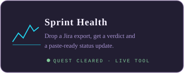
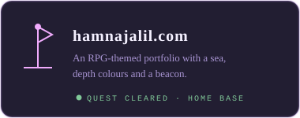

I build the systems that ship games and products, not just the slides about them.

### Quest log

  
  
  

**Side quests:** [Pizza-RAG-Chatbot](https://github.com/hamnajalil/Pizza-RAG-Chatbot), a fully local RAG agent · [agile-final-project](https://github.com/hamnajalil/agile-final-project), backlog to sprint on a kanban board

### Current quest

Building small tools that make production teams faster, and running my own projects on them. Open to Technical PM / Producer roles and freelance work.

<a href="https://hamnajalil.com">hamnajalil.com</a> · <a href="https://hamnajalil.com/HAMNA_JALIL.pdf">Resume</a> · <a href="mailto:hamnajalil@gmail.com">Say hi</a>

